# SDD I2 · Sistema de análisis con Sentinel-2

**Estado: decisiones de experiencia y período confirmadas; especificación de implementación v1.**

Actualización de implementación I2: servicio HTTP, catálogo regional, dibujo de geometrías complejas, mosaicos NDWI y fotogramas del salar completo implementados. Evidencia en [specs/i2-web-analysis/tasks.md](specs/i2-web-analysis/tasks.md) y operación en [processing/API.md](../processing/API.md). Sol conserva la UI/reproducción y Gaby el despliegue/publicación. Los límites científicos/cartográficos se mantienen explícitos.

Repositorio: https://github.com/ignaMartin22/Vega  
Rama local: `i2/sdd-sentinel2`  
Base actualizada: `main`, commit `f147464` (11/11/2026).

## 1. Qué queremos construir

El componente de Vega que, ante una solicitud desde un botón de la web, recibe el salar/humedales elegidos por el usuario e intervalo de fechas, busca imágenes reales de Sentinel-2 y calcula automáticamente indicadores sobre el agua. El ámbito de la demo comprende Salta, Jujuy y Catamarca. Produce resultados que Gaby puede publicar mediante el relayer y Sol puede mostrar en la web.

La entrega es un sistema ejecutable y reproducible. Una serie histórica generada sirve para demostrarlo y como respaldo; por sí sola no define la entrega completa.

En este documento, SDD significa especificar el comportamiento y su diseño antes de continuar la implementación. Las decisiones del usuario quedan fijadas; los acuerdos operativos pendientes con el equipo se identifican explícitamente.

## 2. Equipo y límites

| Persona | Rol | Responsabilidad |
|---|---|---|
| Igna | I1 | Contratos, deploy y configuración on-chain |
| Usuario + Codex | I2 | Fuente Sentinel-2, análisis, calidad, procedencia y salida de datos |
| Gaby | I3 | Relayer, publicación, infraestructura y operación del servicio |
| Sol | I4 | Frontend, interacción, mapa y visualización |

I2 trabaja principalmente en `processing/` y sus datos de prueba/documentación. Los formatos compartidos están definidos en [INTERFACES.md](INTERFACES.md). Agregar una API, un botón o una tarea periódica requiere definir el punto de integración con Gaby/Sol, además del cálculo de I2.

## 3. Confirmado y pendiente

Confirmado por el usuario:

- La fuente debe ser Sentinel-2.
- El sistema debe realizar los análisis.
- El trabajo debe estar en una rama nueva.
- Antes de seguir se debe definir el SDD y hacer las preguntas necesarias.
- El reparto del equipo es el de la tabla anterior.
- El análisis se inicia desde un botón de la web.
- El usuario elige salar y humedales; la demo no queda limitada a las tres áreas experimentales anteriores.
- Se deben contemplar salares de Salta, Jujuy y Catamarca, incluidos los compartidos entre provincias.
- Se admiten ambas formas de elección de humedal: seleccionar desde catálogo y dibujar un área en el mapa.
- La animación muestra la evolución temporal mediante imágenes satelitales reales del salar seleccionado, ordenadas por fecha. No se requiere una animación de acercamiento orbital.
- El período inicial es los últimos tres años respecto de la fecha de la solicitud. No queda fijo en 2023–2025.
- La entrega sigue siendo el viernes 13/11/2026 a las 09:00 de Argentina; se prioriza una versión funcional lo antes posible.
- El usuario delega revisar el repo y recomendar qué resultados conviene mostrar.

Registro de decisiones:

| ID | Decisión | Por qué cambia el diseño |
|---|---|---|
| Q1 | Resuelto: botón en la web | Requiere una interfaz HTTP y seguimiento del trabajo; ya no basta un comando |
| Q2 | Resuelto: catálogo y dibujo de áreas | Se necesitan validación de geometría e identidad/versionado de áreas nuevas |
| Q3 | Resuelto: imágenes mostrando la evolución | Se entrega una secuencia temporal de imágenes, sin exigir cámara orbital |
| Q4 | Resuelto: salares de Salta, Jujuy y Catamarca, también compartidos | Se necesita catálogo regional y relación de provincias múltiple |
| Q5 | Propuesta de I2: NDWI, evolución, diferencia absoluta, imágenes y calidad | Conserva el indicador existente; superficie de agua requiere validación adicional |
| Q6 | Resuelto: últimos tres años por defecto | Consulta relativa a la solicitud; muestreo mensual propuesto para la primera versión |
| Q7 | Decisión técnica propuesta: trabajo asincrónico, sin prometer duración antes de medir | El botón responde con un ID; Sol muestra fases reales y permite volver al trabajo |
| Q8 | Acuerdo pendiente con Gaby: despliegue y persistencia | I2 prepara un servicio ejecutable con configuración de entorno documentada |
| Q9 | Validación externa pendiente: límites y umbrales | Mostrar calidad y cruces numéricos; no declarar un diagnóstico ambiental validado |
| Q10 | Resuelto: viernes 13/11 a las 09:00; cuanto antes, mejor | Priorizar flujo vertical funcional antes de ampliar presentación |

No quedan preguntas bloqueantes sobre selección, tipo de animación o período inicial. La recomendación Q5 mantiene el indicador del repo y el alcance científico acotado. La coordinación de infraestructura y la validación ambiental siguen como tareas del equipo, sin pedir al usuario que elija bibliotecas.

## 4. Flujo desde la web

```mermaid
flowchart LR
    A[Usuario elige salar y humedales] --> Z[Sol: botón Analizar]
    Z --> J[API de análisis: crea trabajo]
    J --> B[I2 busca escenas Sentinel-2]
    B --> C[I2 valida imagen y cobertura]
    C --> D[I2 calcula indicadores acordados]
    D --> E[Resultados y procedencia]
    E --> F[Gaby: relayer y publicación]
    F --> G[Igna: contrato Avalanche]
    E --> H[Sol: información para visualizar]
    G --> H
```

Sol solicita el análisis por HTTP y consulta su progreso. I2 provee el motor y una interfaz de análisis; Gaby acuerda su exposición, ejecución y almacenamiento. Los endpoints de [I2-API-PROPOSAL.md](I2-API-PROPOSAL.md) son una propuesta revisable, no una modificación de las interfaces compartidas existentes.

La animación de Sol acompaña estados reales del trabajo. Finalizar una animación no implica que terminaron el procesamiento o la publicación. Debe permitir mostrar resultados en caché identificados como tales sin fingir que se recalcularon.

## 5. Comportamiento mínimo propuesto

1. Recibir desde la web el salar, las áreas seleccionadas y el intervalo de fechas mediante una entrada documentada.
2. Validar coordenadas, fechas y cobertura de las imágenes disponibles.
3. Buscar Sentinel-2 L2A en un catálogo público, con paginación.
4. Leer las bandas requeridas y excluir píxeles inutilizables.
5. Calcular NDWI por polígono como indicador del MVP recomendado a partir del esquema actual del repo.
6. Registrar escena, fecha de adquisición, calidad, parámetros y resultado.
7. Generar la salida compatible con Gaby; usar el hash compartido del repo.
8. Distinguir éxito, datos insuficientes y fallo técnico. No producir números ficticios cuando falta información.
9. Poder repetir un análisis y explicar de qué imágenes y geometría salió.

La solicitud desde la web forma parte del alcance confirmado. La ejecución periódica no fue solicitada. La publicación de transacciones pertenece al relayer y se muestra como un estado separado del análisis.

### 5.1. Catálogo regional y salares compartidos

- Un salar tiene una identidad estable y `provinces: []`; puede pertenecer a varias provincias sin duplicarse por filtro.
- La selección territorial se basa en su geometría y las jurisdicciones documentadas, no únicamente en el centroide.
- Elegir una provincia no recorta ni divide un salar compartido. Se conserva su identidad y se indican sus provincias.
- El usuario puede elegir un salar del catálogo regional y seleccionar cuerpos de agua cartografiados o dibujar un área. Se implementó el snapshot regional IGN/USGS y su cobertura verificable. Es completo respecto de las capas consultadas, no un inventario ecológico exhaustivo; las áreas no cartografiadas se dibujan dentro del ámbito permitido.
- Los polígonos de salar y de humedal son conceptos distintos: no se promedia automáticamente toda la costra salina como si fuera un único humedal.
- El diseño de catálogo admite geometrías Polygon/MultiPolygon. Si una zona cruza teselas Sentinel-2, el motor debe combinar cobertura compatible o informar el caso no soportado; no descartar silenciosamente parte de la zona.
- En una composición de teselas se debe controlar fecha/adquisición, grilla, máscara y solapamientos. No se contarán dos veces píxeles del solapamiento ni se presentarán fechas mezcladas como una sola captura.
- Cada humedal necesita `wetlandId` estable para la integración on-chain. La elección de provincias no modifica ese ID.
- Un área dibujada conserva geometría y versión. No se reutiliza un ID de catálogo para una geometría diferente. Los IDs nuevos requieren un registro persistente con control de colisiones; el frontend no asigna IDs arbitrarios destinados al contrato.
- Las áreas dibujadas se validan contra el ámbito territorial permitido. Si cruzan un límite provincial interno del ámbito, se conservan completas; el límite entre provincias no divide el humedal. Un área inválida o fuera del ámbito recibe un error explicado antes del cálculo.

### 5.2. Período y selección temporal

- El servicio resuelve y persiste `to` al crear la solicitud y calcula `from` tres años calendario antes, en UTC. Si no existe el día en el año de destino (29 de febrero), se ajusta al último día válido del mes.
- La propuesta técnica es dividir ese intervalo en 36 ventanas mensuales consecutivas ancladas en sus extremos, sin solapamientos ni fechas fuera del intervalo. El usuario confirmó tres años; el muestreo mensual es una decisión de implementación para limitar espera y volumen.
- Ejemplo: una solicitud del 11/11/2026 consulta desde el 11/11/2023 hasta su fecha/hora resuelta del 11/11/2026. No promete una captura del mismo día: la fecha de cada observación es la de adquisición real.
- Por área y ventana, ordenar escenas por nubosidad, fecha e ID y elegir la primera que supere los controles. La búsqueda mensual puede probar candidatas siguientes ante cobertura insuficiente.
- Si no existe imagen aceptable, conservar el hueco y su motivo. No interpolar valores ni imágenes para completar el período.
- El histórico experimental 2023–2025 se conserva como prueba separada; no se devuelve como si fuera automáticamente el período actual de cualquier solicitud.

### 5.3. Resultados recomendados para la primera demo

| Elemento | Qué muestra | Motivo |
|---|---|---|
| Vista satelital | Ubicación del salar y humedales; imagen con fecha y fuente | Hace visible qué se está analizando |
| NDWI por humedal | Valor más reciente aceptable y fecha de captura | Es el indicador ya definido por el repo y el contrato |
| Evolución | Serie temporal con huecos y umbral, si está configurado | Permite comparar observaciones y su estacionalidad |
| Comparación | Dos imágenes/fechas y diferencia absoluta de NDWI | Da contexto visual; evitar porcentajes de cambio de un índice que puede ser negativo o cero |
| Calidad | Fracción válida del AOI, píxeles usados y motivo de escenas descartadas | Evita interpretar nubes o falta de datos como cambios ambientales |
| Verificabilidad | Escena de origen y hash; estado de publicación, tx y verificación cuando existan | Conecta con el objetivo blockchain sin confundir análisis y sellado |

Recomendación: mantener NDWI como indicador obligatorio del MVP. La estimación en hectáreas de agua abierta y una clasificación automática de daño quedan para una ampliación validada. No se infiere volumen de agua ni causalidad minera a partir de NDWI.

### 5.4. Animación temporal: reparto de responsabilidades

Sol implementa reproducción, pausa, velocidad y control de fecha en la web. I2 entrega una secuencia temporal de imágenes utilizables con geometría, límites, escena o escenas componentes, fecha, calidad y atribución. La secuencia cubre los últimos tres años, con fechas disponibles; no se exige un fotograma por mes si faltan capturas válidas.

- Todos los fotogramas de una secuencia usan la misma extensión, proyección de presentación y tamaño. No se cambia el encuadre entre fechas para aparentar una variación de superficie.
- Mantener una política de color consistente y documentada, evitando un ajuste visual diferente por fecha que simule cambios inexistentes.
- I2 prepara imágenes PNG/JPEG o tiles que el navegador pueda consumir; una URL a un GeoTIFF grande no completa esta entrega.
- Vincular fotogramas y mediciones por `sceneId`/fecha. Si distintos humedales usaron escenas diferentes, no atribuir todas las mediciones al mismo fotograma: mostrar la correspondencia real.
- Una composición del salar completo puede requerir varias teselas de la misma adquisición compatible. Se conserva esa procedencia y se explicita cobertura faltante; no se mezclan fechas silenciosamente.
- La imagen muestra la fecha de adquisición, no solo el mes del gráfico. Sol no reproduce capturas ausentes como si fueran nuevas observaciones.

Las imágenes presentadas como evidencia deben corresponder a las escenas realmente utilizadas. La animación es una secuencia histórica, no una señal en directo ni una generación artificial de cambios.

## 6. Integración que ya define el repositorio

La interfaz actual entrega `HashedMeasurement[]` por archivo. Cada registro contiene `schema`, `wetlandId`, `ndwi` entero escalado por 10.000, `sceneId`, `timestamp` de adquisición, `cloudCover`, `validPixels`, `method` y `dataHash`.

- Conservar esta salida permite que I3 avance sin cambiar el contrato desplegado.
- Si el usuario pide superficie de agua, nuevos indicadores o polígonos arbitrarios, habrá que definir campos auxiliares y su relación con IDs/contrato con el equipo. No se asume que esos datos ya caben en el esquema v1.
- Un informe auxiliar puede incluir geometría y calidad sin alterar la interfaz vigente. Hoy el hash del registro v1 no compromete explícitamente el hash de la geometría.
- Según el avance de I1 en `main`, ya existe deploy en Fuji; I2 no necesita una wallet para analizar imágenes.
- El contrato admite IDs numéricos, pero el repo solo coordina umbrales iniciales para 1/2/3. Ampliar el catálogo requiere acordar IDs y umbrales con Igna; un humedal sin umbral puede tener mediciones sin que se genere una alerta ambiental.

## 7. Decisiones técnicas propuestas, todavía revisables

- Mantener TypeScript/Node para integrarse al monorepo existente.
- Extraer el cálculo actual de los scripts CLI a funciones que pueda invocar un servicio. La CLI queda como herramienta de prueba; el disparador del producto será la web.
- Ejecutar análisis como trabajos asincrónicos con estados consultables y resultados separados por solicitud; no sobrescribir un único archivo global cuando dos usuarios analizan zonas distintas.
- Consultar Earth Search y leer COG por ventana para evitar descargar escenas completas.
- Calcular NDWI con B03 y B08, usando SCL para excluir nubes y otros píxeles inválidos.
- Reproyectar áreas a la grilla de la escena y respetar escala/offset de reflectancia.
- Aplicar un mínimo de cobertura válida y conservar las razones de rechazo. El 50% usado en el experimento es una propuesta, no una decisión científica aprobada.
- Usar tres años móviles, con consulta y escenas resueltas por trabajo. La fecha de adquisición se distingue de la fecha de cálculo y de la de publicación.

NDWI es un indicador espectral: no equivale a litros de agua, contaminación ni prueba de causalidad minera. Los umbrales ambientales requieren interpretación y validación.

## 8. Criterios de aceptación propuestos

- Un evaluador puede pulsar Analizar en la web, seguir su estado y obtener resultados calculados desde Sentinel-2. Si se reutiliza una caché válida, se indica su procedencia y fecha de cálculo.
- Cambiar zona o fechas modifica la consulta y el análisis según el alcance acordado.
- Se puede rastrear cada registro a su escena y geometría.
- Una imagen cubierta por nubes o sin datos suficientes tiene un estado explícito.
- El archivo producido pasa el dry-run de I3 y los controles del esquema compartido.
- Hay pruebas del cálculo, reproyección/máscara y tratamiento de fallos.
- Sol y Gaby cuentan con ejemplos y documentación de la interfaz elegida.
- Los filtros de Salta/Jujuy/Catamarca conservan un único ID para un salar compartido y muestran todas sus provincias.
- Se verifica la cobertura declarada del catálogo; los tres AOI experimentales no se presentan como cobertura de las tres provincias.
- Se puede seleccionar un humedal de catálogo y crear una segunda solicitud dibujando otra área; sus identidades y resultados no se confunden.
- El período por defecto se calcula respecto de la solicitud, incluyendo el ajuste de años bisiestos; no contiene el rango experimental fijo.
- La secuencia temporal tiene fotogramas georreferenciados con fecha/escena, encuadre consistente y correspondencia con el análisis. Huecos, capturas diferentes por AOI y composiciones de teselas son explícitos.
- Sol puede reproducir y pausar la evolución del salar elegido sin que eso altere estados del análisis o publicación.
- Las solicitudes simultáneas no mezclan archivos, IDs, progreso ni resultados.
- Se miden tiempos de una solicitud de tres años para acordar recursos con Gaby; no se declara un tiempo máximo sin prueba en el entorno de despliegue.

## 9. Qué existe de la exploración anterior

En la rama se conservaron cambios locales sin commit: un procesamiento por comando, pruebas, áreas piloto del Salar del Hombre Muerto y 105 mediciones experimentales de 2023–2025. Se preservan para poder revisarlos y reutilizar lo que corresponda al SDD final.

Ese salar, esas áreas, el período y los parámetros fueron elegidos durante la exploración: **no se consideran aprobados como configuración final por el usuario**. Hombre Muerto puede ser un caso de prueba dentro del ámbito, pero no reemplaza la selección regional solicitada. Los archivos anteriores que hablan de una entrega lista describen esa prueba técnica; no cierran el alcance de I2. No se publicó esta implementación en GitHub ni se enviaron mediciones a la cadena desde esta sesión.

## 10. Secuencia de trabajo

1. Decisiones de producto cerradas: catálogo + dibujo, evolución por imágenes y tres años móviles.
2. Preparar y revisar con Gaby/Sol el contrato HTTP, estados y datos del mapa. Construir primero un recorrido completo desde el botón hasta un resultado, conservando los tres años como alcance final.
3. Verificar fuente/cobertura del catálogo regional y reglas de identidad para zonas compartidas.
4. Extraer y adaptar el motor experimental a solicitudes parametrizadas, aisladas y reproducibles; completar cobertura de teselas/geometrías necesaria.
5. Entregar imágenes/metadatos de las escenas y resultados NDWI para que Sol implemente la presentación.
6. Integrar resultados con Gaby conservando el esquema existente; coordinar IDs y umbrales con Igna.
7. Verificar criterios de aceptación y preparar una entrega revisable en esta rama.

Los requisitos confirmados se consideran fijados. Las propuestas de presentación y de integración se distinguen de acuerdos aún pendientes con el equipo. El alcance no se reduce a tres humedales fijos ni se sustituye la evolución temporal por una animación orbital.

## 11. Fuentes consultadas para las propuestas

- Alcance y formatos actuales: [README del repo](../README.md), [INTERFACES.md](INTERFACES.md), `shared/src/types.ts` y componentes del frontend.
- Catálogo geográfico a investigar: [Nomenclador Geográfico Nacional](https://dig.ign.gob.ar/nomenclador/mapa/) y [Geoportal IGN](https://geoportal.ign.gob.ar/). Que existan estos recursos no implica que ya se haya verificado un catálogo completo de polígonos de salares/humedales.
- NDWI y bandas Sentinel-2: [funciones del servicio Sentinel-2 de Esri](https://sentinel.arcgis.com/arcgis/rest/services/Sentinel2/ImageServer/rasterFunctionInfos).
- Límites de índices para mapear agua: [estudio de índices con Landsat/Sentinel-2](https://pmc.ncbi.nlm.nih.gov/articles/PMC12271537/). La recomendación de priorizar NDWI y comparar imágenes es una decisión de alcance del MVP, no una validación científica de los umbrales del repo.
